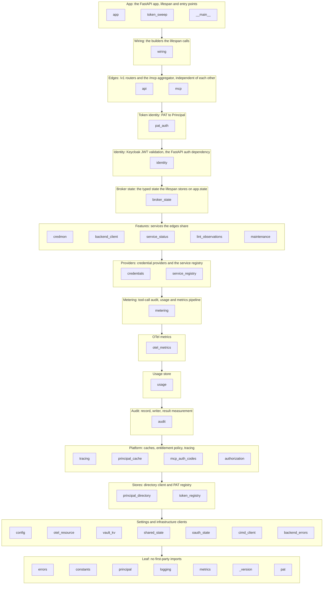

# Architecture

## Overview

The AF MCP Platform sits between LLM clients (Claude, Gemini, or any MCP-capable
client) and a growing set of ATLAS/AF backend services. Its job is to
ensure that method calls (MCP "tool" calls) are authenticated, authorized, and
executed with the right per-user credentials — without ever handing raw secrets
to the LLM or requiring backends to implement their own auth plumbing.

Two distinct client identities authenticate against the same Keycloak realm,
then hit the broker the same way, but end up with different credential shapes:

```
mcp-portal              MCP-client identities
(portal SPA;         (Claude Desktop, Claude Code, et al. — bootstrap a
 Code+PKCE)            broker-issued PAT instead; see docs/auth.md#mcp-
                       oauth-discovery-pat-bootstrap-issue-140)
     │                          │
     ▼                          ▼
AF Keycloak OIDC          Broker's own /v1/oauth/authorize,
(operator-configured        which itself logs in against the
 realm) issues an            same Keycloak realm on the client's
 aud=mcp-gateway token       behalf, then mints a PAT (mcp_pat_…)
     │                          │
     └──────────┬───────────────┘
                 ▼
       Bearer sent directly by the client — a raw Keycloak JWT for
       the portal, a broker-issued PAT for most MCP clients
```

```
LLM client / Portal SPA
    │  Authorization: Bearer <aud=mcp-gateway token>
    ▼
FastMCP Aggregator (mounted at /mcp)
    │  IdentityMiddleware — validates the Bearer itself, same
    │  identity.get_principal() /v1 uses; no ForwardAuth proxy
    │  in this path — see docs/auth.md
    ▼
    │  EntitlementMiddleware (tools/list) / AuthorizationMiddleware
    │  (tools/call) — permission check in-process against the same
    │  functions POST /v1/authorize calls; AuthorizationMiddleware
    │  also writes the audit record for every call
    ▼
    │  client_factory — for auth_type="bearer" backends, mints the
    │  caller's credential in-process via the same provider code
    │  POST /v1/credential calls (rucio token, x509 proxy, IAM token, …)
    ▼
Backend MCP server  (rucio-mcp, ami-mcp, condor-mcp, …)
    │  result / error
    ▼  (back up the chain)
LLM client / Portal SPA
```

No ForwardAuth proxy sits in front of any host or path — `ingress-portal.yaml`
serves every portal page (public and authenticated alike) from a single `/`
catch-all, and `/v1/*`/`/mcp/*` on either host (`ingress-mcp.yaml` for
mcpHost, `ingress-portal-api.yaml` for portalHost) carry no gate of their
own. The portal SPA enforces its own client-side OIDC login
(`portal/src/lib/auth.ts`). Every caller obtains its own `aud=mcp-gateway`
token and presents it directly; the broker's validator is identical
regardless of which client identity issued the token. See
[docs/auth.md](auth.md) for the full design record.

### `/mcp` transport mode and replica safety (issue #128)

MCP streamable-HTTP sessions are **in-process state**: the session a
client's `initialize` creates lives only in the memory of whichever broker
pod handled it. At `replicaCount: 1` that's a non-issue; at
`replicaCount > 1` it matters, because the chart's ingress load-balances
each request independently with no session pinning by default.

- **Stateless (`broker.mcpStatelessHttp: true`, the default)** — every
  request is fully self-contained; the server never consults or requires
  cross-request session state, so any replica can serve any request with
  no affinity infrastructure. Progress/log notifications emitted *during*
  a tool call are still delivered on that call's own response stream
  (verified against fastmcp 3.4.4). What's lost is the standalone GET SSE
  stream used for messages *outside* an active call —
  `notifications/tools/list_changed` and any future server-initiated
  sampling/elicitation request.
- **Stateful (`broker.mcpStatelessHttp: false`)** — required only if a
  backend/feature needs that standalone stream. Safe at `replicaCount > 1`
  *only* with session-affinity in front of the ingress, e.g.:
  ```yaml
  nginx.ingress.kubernetes.io/upstream-hash-by: "$binary_remote_addr"
  ```
  Hashing on `$http_mcp_session_id` instead does **not** work: `initialize`
  carries no session header, so it hashes an empty value onto an arbitrary
  pod, and that pod's newly-minted session id may itself hash to a
  *different* pod for the client's next request. Client-IP hashing needs
  the ingress to see the real client IP (real-IP/forwarded-headers
  configuration, or every client behind the same NAT egress lands on one
  pod) but needs no client cooperation, unlike cookie affinity. A shared
  session store (Redis/etc.) is not a viable alternative: the SDK session
  holds a live `anyio` task group and open memory streams, not
  serializable state.
- Running a stateful aggregator at `replicaCount > 1` without that
  affinity in place produces exactly the failure issue maniaclab/af-mcp-platform#128 describes: a
  session's later request lands on a replica that never created it, which
  terminates it — surfacing as an intermittent `McpError: Session
  terminated` that no single-replica test will ever catch. The broker
  cannot see whether affinity is configured upstream, so it can only warn
  (`mcp_stateful_multi_replica` in the broker logs) rather than refuse to
  start; the chart's `NOTES.txt` warns at install/upgrade time for the
  same combination.

### Replica consistency and the shared state store

The broker runs more than one replica (`broker.replicaCount`, default 2),
and some of its state lives in process memory. Where that state only makes
sense as one value for the whole deployment, a per-replica copy is wrong, not
merely stale: a brute-force limiter whose budget multiplies with the replica
count is not a limiter. The broker therefore has a small shared state layer
(`shared_state.py`, a `SharedState` ABC) with two backends:

- `in_memory` (default): process-local. Correct for exactly one replica.
- `redis`: any server speaking the redis protocol, reached through an
  operator-supplied `redis://` or `rediss://` URL. [Redis](https://redis.io)
  is the recommended store; [Valkey](https://valkey.io), Dragonfly and KeyDB
  also work. The chart does not deploy a store, the same as it does not deploy
  Postgres. The state is small, short-lived counters and caches, so it is
  deliberately kept out of Postgres and Vault.

**Scaling is safe by construction.** Running more than one replica with no
shared store must be an explicit choice, not a silent degradation:

- The chart refuses to render (`fail`) when `broker.replicaCount > 1` and
  neither `broker.sharedState.url` nor `broker.sharedState.existingSecret.name`
  is set, unless `broker.sharedState.allowPerReplicaState: true`.
- The broker refuses to start (`Settings` validation) when
  `MCP_REPLICA_COUNT > 1` and `SHARED_STATE_URL` is empty, unless
  `ALLOW_PER_REPLICA_STATE=true`. The chart sets `MCP_REPLICA_COUNT` itself;
  non-chart deployments set it by hand. With the escape hatch the broker logs
  `per_replica_state` at startup and the chart's `NOTES.txt` prints a warning.
- Upgrading an existing multi-replica release that has no store yet therefore
  needs either a store or `allowPerReplicaState: true` in its values *before*
  the upgrade.

Operator setup:

```yaml
broker:
  replicaCount: 2
  sharedState:
    # redis:// or rediss://. Put a URL with a password in a Secret instead:
    #   existingSecret: {name: broker-shared-state, key: url}
    url: "rediss://redis.cache.svc:6379/0"
    # NetworkPolicy egress to the store (when networkPolicy.enabled):
    networkPolicy:
      namespaceSelector: {kubernetes.io/metadata.name: cache}
      podSelector: {app.kubernetes.io/name: redis}
      # cidr: 203.0.113.0/24   # instead of selectors, for a managed instance
      port: 6379
```

Every key and pub/sub channel the broker uses on the store starts with
`broker.sharedState.keyPrefix` (env `SHARED_STATE_KEY_PREFIX`). The chart
defaults it to `<release name>:`, so two releases can share one store without
seeing each other's counters or cache invalidations. A redis database number
in the URL does not isolate them: pub/sub ignores it. Changing the prefix on a
running release drops the state held under the old prefix once. That state is
short-lived (rate-limit windows, PAT mint windows, authorization codes, lint
tables), so the effect is a reset of those counters and a brief reset of the
cross-replica cache invalidation, not data loss.

Outside the chart set `SHARED_STATE_URL` (and `MCP_REPLICA_COUNT`) directly,
and `SHARED_STATE_KEY_PREFIX` to something unique per release (default
`af-mcp:`).

Per-replica state in the broker, what happens at more than one replica
without a store, and what each item does when the store is down. "Phase"
is the order in which items move onto the store; phases 1 to 4 are
implemented today and "(done)" marks the ones that have.

| Item | Location | Effect at N > 1 without a store | Consistency need | Store down | Phase |
|---|---|---|---|---|---|
| Unlock brute-force limiter (5 failures / 15 min per uid) | `credentials/cache.py`, `CredentialCache` | Budget multiplied by N (security-relevant) | Strong: one counter per uid, atomic increment | Falls back to a per-replica limit and logs `credential_cache.shared_state_unavailable`; never fails open, never blocks unlock | 1 (done) |
| Per-tool call rate limits (`rate_limits` in `policy.yaml`) | `authorization/rate_limit.py`, `AuthorizationMiddleware` | Budget multiplied by N | Strong: one counter per rule and subject, atomic increment | Falls back to a per-replica count and logs `tool_rate_limit.shared_state_unavailable`; never fails open, never refuses every call | 1 (done) |
| PAT mint rate window (10 mints / hour per subject) | `api/tokens.py`, `TokenRegistry` | Mint cap multiplied by N | Strong: one counter per subject, atomic increment. Soft anti-abuse cap, not a security boundary | Falls back to a per-replica count and logs `token_registry.shared_state_unavailable`; never refuses every mint | 2 (done) |
| Per-(subject, service) tools/list cache and 30 s negative cache | `mcp/aggregator.py`, `mcp/cache_invalidation.py` | Invalidate-on-link/revoke reaches only the replica that handled it | Eventual: the drop is published to every replica (pub/sub), so staleness is the delivery delay, not the TTL | Fails open: the local drop still happens, the broadcast failure is logged as `list_cache_invalidation.shared_state_unavailable`, and other replicas fall back to TTL-only staleness. A replica that resubscribes after an outage drops every cached listing, since it may have missed messages | 3 (done) |
| Caller list-failure records | `service_registry.py` (`_caller_list_failures`) | Status differs by replica until each re-lists | Eventual: cleared with the listing entries by the same invalidation, otherwise refreshed by each replica's own listings | Fail open | 3 (done, via the invalidation above) |
| Admin lint tables (annotation mismatches, tool-mapping drift; #332) | `lint_observations.py`, `mcp/middleware/entitlement_mw.py`, `api/admin.py` | Each replica reports only what it has observed | Eventual: one record per service in the store, written whenever a caller lists that service's tools, so any replica answers the same | Falls back to what this replica observed and logs `lint_observations.shared_state_unavailable`; never reports a service observed that no one listed | 4 (done) |
| MCP OAuth authorization codes | `mcp_auth_codes.py` | Codes are self-contained (Fernet, `BROKER_STATE_KEY`), so any replica opens them; the single-use marker is per replica, so a replay on another replica succeeds | Strong, single use: one `mcp_auth_code:<id>` counter per code | Redemption is refused with `invalid_grant` (fail closed); the code is not consumed, so the client retries or restarts the flow | 1 (done) |
| Revocation, credentials, principal cache, credmon lease | Vault | Already shared | n/a | n/a | n/a |
| Usage, maintenance mode | Postgres | Already shared | n/a | n/a | n/a |

Cache invalidation failure policy: link and revoke drop the handling
replica's cached listings first, synchronously, then publish
`{origin, subject, target}` on one pub/sub channel of the store; every other
replica drops the same entries on receipt, and a replica ignores its own
message. A per-subject generation counter that readers check before serving a
cached entry would also work, but it puts a store round trip, bounded only by
the 2 s socket timeout while the store is down, in front of every `tools/list`
and every `tools/call` that carries arguments. Pub/sub keeps that path local:
the store is touched by a background subscriber and by the rare link and
revoke events only. Delivery is at-most-once, so a replica resubscribing after
an outage drops *all* cached listings (`list_cache_invalidation.resubscribed`)
rather than trusting that it missed nothing.

Lint observation record: the admin tables read one `lint-observation:<service>`
value per service (JSON: findings and a wall-clock `observed_at`) that every
listing writes, rather than each replica's in-process state, which now only
dedupes the log line and metric. Writes happen when the findings change and
at most every 5 minutes otherwise, and the value expires after 24 hours
without a refresh. `GET /v1/admin/annotation-mismatches` and
`/v1/admin/tool-mapping-drift` list every configured service with its
`last_observed`; `null` means no observation is on record, and the portal
then says "not yet observed since <time>" instead of "no mismatches", which an
empty table alone cannot distinguish. A service that lists no tools in a
listing (unreachable backend, caller with no linked credential) is not
recorded as observed.

Limiter failure policy (the unlock limiter and the tool rate limits, both
through `FallbackSharedState` in `shared_state.py`): when the store is
unreachable the limiter counts per replica instead. That is exactly the
behaviour without a store, so an outage never makes the limiter weaker than
the operator already accepted by being unable to reach it, and it never turns
a store outage into a loss of x509 unlock or of every tool call for every
user. Caches always fail open: a stale or
missing entry costs one extra backend call, never correctness.

MCP authorization code failure policy: the opposite of the limiter. A
per-replica fallback would let a replayed code redeem once on each replica,
and RFC 6749 section 4.1.2 requires a code to be single use, so when the
store is unreachable `/v1/oauth/token` answers `invalid_grant` and logs
`mcp_oauth.token_refused_shared_state_unavailable`. The bootstrap is a
one-shot the client can restart, so refusing costs one retry.

---

## Elwood vocabulary alignment

This platform predates the Elwood v5 glossary used across the parent
collaboration; this section maps the platform's terms onto it. In Elwood
terms the broker is the **Gateway / Orchestration-Platform boundary**, not a
Service; each registered MCP server is a **Service**; the tools a Service
exposes are **Methods**.

| Platform term | Elwood v5 term | Note |
|---|---|---|
| service (registry entry, `services.yaml`) | Service | A packaged interface to one backend system — an MCP server. |
| tool (MCP wire term) | Method | "tool" remains correct in code and on the MCP wire; it is what the MCP protocol calls a Method. |
| permission (permission string, `policy.yaml` / `GET /v1/permissions`) | **no Elwood equivalent — NOT an Elwood Capability** | An Elwood Capability is a named agent role owning Services. The platform's permission strings were called "capabilities" before the rename; "permission" is now the term everywhere. |
| broker | Gateway / Orchestration-Platform boundary | The user-facing entry point; the multi-agent orchestration layer sits above this platform. |
| LLM client | Reasoning Engine + Agent (client side) | "Agent" (Elwood) is the running implementation of a Capability — never a generic word for LLM clients. |

**Things still called "capability"** — the platform's permission strings
used to be a third sense of this word, but are renamed to **permission**,
resolving that collision. What remains:

1. **An Elwood Capability** — a named agent role that owns Services.
2. **The VOMS FQAN `/Capability=NULL` field** — fixed WLCG grid vocabulary
   that appears in x509/VOMS proxy log lines, unrelated to the above.

In these docs, "permission" means the platform's permission strings;
"capability" only ever means one of the two senses above (or the MCP
protocol's own client capabilities).

---

## Trust tiers

Elwood v5 / Shannon defines three trust tiers. Each deployed app's tier is
declared alongside its deployment manifests in the GitOps repo;
this section declares the platform's own posture.

- **user-tier** — lowest privilege: acts only with per-user credentials.
- **service-tier** — interacts with shared infrastructure; requires a
  runbook, a policy, and a named reviewer.
- **infrastructure-tier** — holds platform-wide secrets or can modify the
  platform; the highest governance bar.

### The broker is infrastructure-tier

The broker holds the AF Broker Identity Token signing key
(`broker.identityToken.existingSigningKeySecret`) and the Vault access
behind the token store (`broker.oauth21.tokenStore`), where every linked
user's brokered credentials are persisted — together, the ability to obtain
a credential for any linked user. It also runs a standing Keycloak
directory-read client (`broker.keycloakAdmin`, realm-management
`view-users` + `query-groups` only). That is why its governance bar is the
strictest in the platform: fail-closed startup (a missing signing key,
unmatched x509 wiring, or a service left with no gate at all refuses to
start rather than degrading), authority never carried in a token
(broker-issued JWTs are identity assertions, nothing more — see
[docs/auth.md](auth.md)), and every secret delivered as an
externally-created SealedSecret the chart never mints itself.

### Per-mode tiers differ

The broker's effective privilege depends on configuration:

- **x509 minting.** Proxy minting is delegated to voms-token-service (the
  `serviceUrl` of each `x509` `identityProviders` entry), so the broker pod
  mounts no user homes and holds no Kubernetes RBAC: only voms-token-service
  reads users' `~/.globus` directories.
- **Credential execution model** (`ExecutionModel` in
  `broker/src/af_mcp_broker/credentials/base.py`). `DELEGATED` providers
  forward a per-user credential — user-tier posture. `ON_BEHALF` providers
  act with a facility service credential on the user's behalf —
  service-tier posture, which is why an ON_BEHALF provider must always
  write an audit record (`CredentialProvider.issue`).
- **Registered services.** Each service's tier is declared where it is
  deployed (the GitOps repo, per above). On the platform side, a service's
  registry entry expresses its posture through `auth_type` (what credential
  the aggregator injects) and `required_permission` (who may call it).
  `required_permission: __none__` — open to any authenticated user — is
  only appropriate for user-tier read-only services.

---

## Import layers

The broker's modules sit in fixed layers. A module imports only from layers
below its own, and `if TYPE_CHECKING:` imports count the same as runtime ones.
`import-linter` enforces this: the contracts live in `[tool.importlinter]` in
`broker/pyproject.toml`, `pixi run -e dev lint-imports` runs them, and
`lint-all` (the CI lint job) includes that task. The layer contract is
exhaustive, so a new top-level module fails the check until it is placed in a
layer on purpose.

Highest layer first. Each band is a layer and each box in it is a module; a
module may import only from the layers below its own. Modules in the same band
are independent: none imports another from its own band, directly or
transitively (so, for example, `api` and `mcp` never import each other).



An arrow means "may import from". Imports may skip layers downward; they may
never point up.

What the layering means in practice:

- `Principal` and `PosixPrincipal` (a `Principal` whose `uid`, `gid` and
  `unixname` are all present, built once by `PosixPrincipal.from_principal`)
  live in `principal.py`, so authorization, credentials and maintenance use
  them without depending on the HTTP layer. Constants such as
  `BUILTIN_SERVICE_NAME` live in `constants.py`, so `config` depends on no
  other first-party module.
- `identity` answers "who is this?" and nothing else. The maintenance gate
  runs after it, as its own step: the `/v1` dependency is
  `api/maintenance_gate.py`'s `require_not_in_maintenance`, and on `/mcp` it is
  `AsgiMaintenanceMiddleware`, installed inside `AsgiAuthMiddleware` by
  `mcp.aggregator.build_asgi_middleware`. A caller who cannot be authenticated
  gets a 401 before the gate is consulted.
- What `api` and `mcp` both need lives below them under public names:
  `service_status` (per-caller availability of a service), `backend_client`
  (building the backend client and listing a service's tools),
  `backend_errors`, `service_registry` and `lint_observations`.
- `broker_state` holds the `BrokerState` dataclass the lifespan stores once on
  `app.state.broker`, and the accessors that read it back:
  `get_broker_state(request)` for `/v1` routes and `identity`,
  `get_state_settings(request)` for the `Settings` the lifespan loaded
  (`BrokerState.settings`, the only settings source in the running app), and
  `broker_state_of(app)` for code that holds the app. `get_settings()` (an
  `lru_cache`) is read only where no app exists: the tracing instrumentation
  at import time. It sits below
  `identity` (which reads the principal cache and the dev-bypass principal
  from it) and above every subsystem it holds, so `api`, `mcp` and `identity`
  can all import it while construction stays in `wiring`. A component a
  deployment may lack is an explicit `X | None` field and each consumer decides
  what absence means; every other field is required, so a state missing one
  cannot be built. A request reaching an app with no state stored fails with
  a `RuntimeError` rather than falling back to defaults. The aggregator and its
  `/mcp` ASGI app are built by the lifespan from the loaded registry, policy,
  settings and stores, passed as constructor arguments, and published on the
  state as `mcp_aggregator` and `mcp_app`; `app.py` mounts a thin ASGI
  callable that serves `mcp_app` from the state.
- Only `api`, `mcp` and `app.py` speak HTTP errors. Everything below raises a
  `BrokerError` subclass from its subsystem (`credentials/errors.py`'s
  `CredentialError` family, `identity.py`'s `IdentityError` family,
  `maintenance.MaintenanceModeError`); the status code and headers live in
  `app.py`'s exception handlers for `/v1`, and `/mcp` turns the same errors
  into a tool error (`mcp.aggregator`) or an ASGI error response
  (`mcp.middleware`). Ruff's banned-api rule (`TID251` in
  `broker/pyproject.toml`) rejects an import of `HTTPException` outside those
  packages.
- By convention a module does not import another module's `_private` name;
  anything shared is public in the module that owns it.

### Startup: builders and teardown

`app.lifespan` is a short sequence of calls, in dependency order, into
builders: plain functions with explicit, typed inputs and a typed result.
A builder that needs one subsystem lives beside it (for example
`maintenance.build_maintenance_store`, `token_registry.
build_token_registry_backend`, `credentials.stores.build_vault_link_stores`);
glue that needs several subsystems lives in the `wiring` package (service
catalog and identity targets, the shared outbound HTTP client, the Vault
client, the credential cache and providers, the principal cache and token registry, the lifetime resources,
the aggregator and its ASGI app). `wiring.state.build_broker_state` assembles the built
subsystems into the `BrokerState` the lifespan stores as `app.state.broker`.

The one pooled outbound `httpx2.AsyncClient` (`wiring.http_client.build_http_client`)
is built first and stored as `BrokerState.http_client`. Builders receive it as
an explicit argument and pass it to the components that call out (credential
providers and token-service clients, the Vault transport, the principal
directory, the JWKS fetch); routes read it from the state. No module holds a
client of its own.

Every resource with a close registers it on one `contextlib.AsyncExitStack`
when it is built, so shutdown closes in reverse build order and a builder that
raises partway through startup still closes everything built before it.

A backend selected by a `Literal` setting (`token_store_backend`,
`token_registry_backend`, `principal_cache_backend`, `metering_backend`) is
built by a `build_*` function that `match`es on the setting and ends in
`assert_never`, so mypy fails when a backend name is added to the `Literal`
without a branch. `usage_store_backend` and `maintenance_mode_backend` select
through `Settings.usage_store` and `Settings.maintenance_store`, unions of
typed configs whose Postgres variant carries its DSN, so the builder matches on
the config class and receives the DSN non-Optional. `shared_state` is chosen by
the URL scheme of `SHARED_STATE_URL`, not by a `Literal`, and keeps its own
`build_shared_state`.

`Settings` keeps the flat, env-var-shaped fields operators set. Feature
settings that must be present together are also exposed as typed sub-configs
built from them (`Settings.vault`, `Settings.credmon_api`, and the two store
unions above); the model validators still raise the same errors at startup, and
a sub-config can only be constructed with every field present.

An `Optional` runtime handle whose presence mirrors the configuration (the
Vault client when `Settings.uses_vault`, the signing-key issuer when an entry
needs it, the per-kind Vault link stores) is narrowed with `errors.require`,
which raises `RuntimeError` with a message, not an `assert`. The Vault stores return typed
link, ticket and proxy records (`X509Link`, `X509Proxy`, `Krb5Link`,
`Krb5Ticket`, `ServiceXLink`, `ServiceXToken`) whose required fields are
non-Optional, validated once when the record is read.

---

## The Four Broker Subsystems

### 1. Identity

Extracts and validates the AF principal from the incoming request.

- Validates the caller's Keycloak-issued JWT directly (`HTTPBearer` +
  `keycloak_dependency` in `api/auth.py`) — there's no ForwardAuth proxy
  forwarding it; every caller (portal SPA, Claude Desktop, `curl`) presents
  its own Bearer. See [docs/auth.md](auth.md) for the per-client-identity breakdown.
- Resolves the POSIX `uid` / `gid` for the principal (needed for x509
  minting, which voms-token-service performs as that user).
- Produces a `Principal` dataclass that flows through the rest of the call.

### 2. Authorization

Answers: "is this principal allowed to call this tool?"

- Policy is declarative YAML (`policy.yaml`) — no code change needed to add a
  permission.
- Each backend target's required permission is declared by
  `required_permission` in `services.yaml` (e.g., rucio requires `read_data`,
  condor-mcp requires `submit_jobs`) — services.yaml is the sole source of truth
  for that mapping; `policy.yaml` doesn't enumerate targets. It's optional:
  omit it and the credential layer becomes the gate instead (the broker
  refuses to start if that would leave the backend with no gate at all), or
  set it to `__none__` to explicitly open the backend to any authenticated
  user. See `docs/adding-a-service.md` for the full model.
- A principal's permissions come from their Keycloak group memberships via
  `group_permissions` in `policy.yaml` (shipped in the chart's policy
  ConfigMap). Every credential type resolves those groups from Keycloak's
  Admin REST API via the `PrincipalDirectory`/principal cache, not from a
  JWT claim — see
  [docs/auth.md#authorization-is-an-attribute-of-the-principal-not-the-token](auth.md#authorization-is-an-attribute-of-the-principal-not-the-token).
- Authorization failures are logged with structured fields (uid, tool, permission)
  and return HTTP 403 to the aggregator.
- The gateway's own methods (`af_whoami`, `af_list_identities`,
  `af_list_mcp_servers`, `af_link_identity`, `af_usage`, `af_search_tools`, `af_rate_limits`) take this exact
  same path: the registry always self-registers a builtin `gateway_service` service
  (prefix `af`, `required_permission: __none__` — issue maniaclab/af-mcp-platform#240, replacing
  issue maniaclab/af-mcp-platform#153's name-based middleware bypass), so they are
  entitlement-checked, audited, and metered like every other method while
  staying available to any authenticated principal, permissions or not —
  they are the bootstrap methods an unlinked, zero-permission caller needs.
  The one builtin difference is dispatch: the aggregator serves them from
  its own local tools, so no credential is minted and nothing is forwarded.
  `gateway_service` appears in `/v1/catalog` and `af_list_mcp_servers` like any
  other service; `services.yaml` can neither define nor unregister it.

#### Dual enforcement: technical gate + model-facing policy

Enforcement on this platform is dual (Elwood v5 re-review, finding #6), and the
two layers do different jobs:

- **Technical gate (authoritative).** The permission check above — declared by
  `required_permission` in `services.yaml`, resolved from the principal's
  groups — is what actually stops an unauthorized call. It returns HTTP 403 to
  the aggregator regardless of what any client or model wants. This layer is
  unchanged by the model-facing layer and remains the sole access-control
  boundary.
- **Model-facing policy (guidance).** The aggregator also exposes policy text
  the LLM agent itself reads and reasons over, surfaced in the MCP `initialize`
  response as the server's `instructions`. It has two parts, composed in
  `mcp/instructions.py`: a **platform preamble** (this is a credential-brokering
  gateway; a denial is a policy decision, not a transient error — do not retry
  a denied call; a missing-credential failure should route the user to
  `af_link_identity`/the portal, not a retry) and a **per-service policy
  section** built from each service's `agent_policy` field (`ServiceSpec.agent_policy`,
  set in `services.yaml`). Each `agent_policy` is 1–3 sentences of model-facing
  guidance — for example, that Rucio read queries are safe but creating or
  deleting *rules* changes real data placement and should be confirmed with the
  user first.

The model-facing layer is **guidance the agent reasons over, not an access-control
boundary** — a capable-but-adversarial model can ignore it, and the technical
gate is what still stops the call. Its purpose is to make a *cooperative* agent
behave well: not retry a denial, route the user to link an identity, and confirm
before mutating real facility state. `agent_policy` is therefore distinct both
from `description` (user-facing catalog UX shown in the portal) and from
`policy.yaml`/`required_permission` (the technical gate). See
`maniaclab/af-mcp-platform#253` for the related `trust_tier` declaration the
preamble also references.

### 3. Credentialing

Fetches or mints the per-user credential required by the backend, given an
authorized principal.

Two axes define the provider matrix:

| | **Short-lived mint** | **Stored brokered token** |
|---|---|---|
| **IAM-based** | Keycloak token exchange (AF-internal only) | `GET /realms/<realm>/broker/<alias>/token` → ATLAS IAM token |
| **x509/VOMS** | voms-token-service `POST /v1/mint` (passphrase supplied at link time), result stored in Vault | The Vault-stored proxy, renewed hands-free with the stored passphrase |

The `CredentialCache` (in-process, async-safe) stores minted credentials keyed by
`(subject, target)` for their lifetime, avoiding redundant minting. See
`spikes/credential-isolation/` for the concurrency validation.

Important: Keycloak Standard Token Exchange (V2) is internal-to-AF only. It
**cannot** mint a token that `atlas-auth.cern.ch` will accept. Use the stored
brokered token path via `GET /realms/<realm>/broker/<alias>/token` for any
credential that must be accepted by external ATLAS services (Rucio, PanDA, AMI).

#### Client ID Metadata Document (CIMD)

Some backends act as their own OAuth 2.1 authorization server rather than
delegating entirely to Keycloak (rucio-mcp is the first). Instead of
pre-registering the broker as a client via Dynamic Client Registration against
every such backend, the broker publishes a public, unauthenticated
`GET /.well-known/cimd` endpoint implementing
[draft-ietf-oauth-client-id-metadata-document](https://datatracker.ietf.org/doc/draft-ietf-oauth-client-id-metadata-document/):
a self-describing JSON document whose `client_id` is the URL of the document
itself. A backend's authorization server fetches this URL directly to learn
the broker's `redirect_uris` (one per `oauth21-direct` entry in
`Settings.identity_providers`) and client metadata, with no per-backend
registration step required.

Every `redirect_uris` entry, and the `redirect_uri` the broker itself sends
in the authorize/token-exchange calls, is built from
`Settings.broker_public_origin` (chart `broker.publicOrigin`) — the
canonical `<scheme>://<host>` the portal SPA is served from, with no
trailing slash. Neither URL is derived from the incoming request: the same
broker deployment is reachable through more than one ingress host, and the
linking flow's nonce cookie is host-only, so a request-relative callback
would land on whichever host a given request happened to arrive through and
drop the cookie on the callback leg. `broker_public_origin` is required
(the broker refuses to start otherwise) whenever `identity_providers`
contains an `oauth21-direct` entry.

#### Identity providers are a single, unified list

`Settings.identity_providers` (env `IDENTITY_PROVIDERS`, chart
`broker.identityProviders`) is the one config surface for every identity
provider the broker can link a user's account to. Each entry is a
discriminated union on `type`:

- `keycloak-brokered` — Keycloak's stored-broker-token pattern (see below),
  handled by `OIDCProvider`. `alias` must match the IdP alias configured in
  the OIDC issuer's realm (e.g. `atlas-oidc`).
- `oauth21-direct` — the broker acting as a direct OAuth 2.1 client (see
  CIMD above), handled by `OAuth21Provider`.
- `x509` — VOMS proxies from the user's grid certificate, handled by
  `X509Provider`; delivered by backend-side redemption rather than header
  injection (see `docs/auth.md`'s identity-provider-types table).

An entry's `alias` doubles as the portal-facing id on `GET /v1/identities` —
there is no separate id-to-alias mapping. `app.py`'s lifespan builds one
`CredentialProvider` instance per entry, keyed by alias, on
`BrokerState.identity_providers`, and registers each entry's `targets` with the
`CredentialRegistry` the same way regardless of provider type — `x509`
entries included: every backend wired with `auth_type: x509` must be
covered by an explicit `x509` entry, or the lifespan refuses to start
(there is no synthesized fallback — see `docs/auth.md`). The identities API
(`api/identities.py`) iterates this dict — in the same order the entries
were configured — to build `GET /v1/identities`'s `providers` list.

#### Linkage detection is per-provider

Before calling `issue()`, the API layer (`api/credentials.py`) gates on
`provider.is_linked(principal)` — an abstract method every `CredentialProvider`
implements against its own storage backend, since linkage state lives in
whichever system actually holds it and cannot be represented uniformly as a
JWT claim:

- `OIDCProvider` probes Keycloak's stored-brokered-token endpoint
  (`GET /realms/<realm>/broker/<alias>/token`) with the principal's own
  bearer token; HTTP 200 means linked. The result is cached per uid for a
  short TTL to avoid a Keycloak round-trip on every call.
- `OAuth21Provider` checks the `TokenStore` for a non-expired stored token
  for `(principal.sub, alias)`.
- `X509Provider` checks for a readable `usercert.pem` + `userkey.pem` pair
  under the principal's home directory.
- `ServiceProvider` always reports linked — the broker's own service account
  is the credential source, so there is no user-side linkage to check.

The service tier's shared token comes from `AF_SERVICE_TOKEN`,
`AF_SERVICE_TOKEN_FILE`, or a `client_credentials` grant (in that order of
precedence). `ServiceProvider.issue()` honours `min_remaining_seconds` like
the per-user providers: a cached token with less than the requested lifetime
left is refreshed, and a refreshed token that is still shorter is returned
as is. A `client_credentials` token expires per `expires_in`. A static token
that is a JWT expires at its `exp` claim (read without verifying the
signature, since the broker is not its audience); once past it, issuance
fails with a "has expired" error until the Secret or file is replaced. A
static token with no readable `exp` (opaque, or a JWT lacking the claim) is
treated as non-expiring, and the broker logs `service.token.static_no_expiry`
once at warning level, because it cannot tell when the token stops working.

An unlinked provider surfaces as `404` before `issue()` is ever called, rather
than as an opaque failure from inside the provider. `GET /v1/identities`'s
`providers[].linked` is built the same way — by probing `is_linked()` — so it
reflects Keycloak's (or the OAuth 2.1 `TokenStore`'s) actual state instead of
a claim that may be absent from the token.

#### Passphrase-unlock rate limiting

`~/.globus` is readable by anyone colocated on the same NFS-mounted home
directory, so a passphrase is the only thing standing between a local
attacker and a user's x509 proxy. `CredentialCache` (`credentials/cache.py`)
counts actual failed unlock attempts — a bad passphrase or a minting-backend
failure, recorded via `record_failed_unlock()` — per uid and raises
`UnlockRateLimitError` once a threshold is exceeded within a fixed window, to
slow brute-force guessing. `X509Provider` calls
`cache.check_unlock_rate_limit()` before sending a passphrase to
voms-token-service, so a locked-out uid never reaches the service
(`x509.py`).

The counters live in the shared state store, so the budget is per uid across
all replicas rather than per replica; see
[Replica consistency](#replica-consistency-and-the-shared-state-store).

Plain cache misses from `CredentialCache.get()` — "nothing cached yet, no
passphrase given" — do **not** count against this budget. That used to be a
single combined bucket (any cache miss counted the same as a bad passphrase
attempt), but it made the ordinary `NeedsUnlockError` probe an MCP client makes
before ever prompting for a passphrase indistinguishable from an attack: a
handful of routine retries could burn through the whole budget and lock the
user out of their own next (correct) unlock attempt — including the very
`POST /v1/x509/proxy` call that would have succeeded, since it also goes
through `get()` first (issue maniaclab/af-mcp-platform#93).

The threshold and window are configurable via `Settings`:

| Env var | Settings field | Default |
|---|---|---|
| `CREDENTIAL_UNLOCK_MAX_FAILURES` | `credential_unlock_max_failures` | 5 attempts |
| `CREDENTIAL_UNLOCK_WINDOW_SECONDS` | `credential_unlock_window_seconds` | 900s (15 min) |

The limit is the number of failures tolerated per window: with the default of 5, the
fifth failed unlock is still allowed to pass and the sixth is refused (the counter
must *exceed* the limit). `check_unlock_rate_limit()` therefore passes at exactly
the limit.

Five attempts is generous enough to tolerate a mistyped passphrase but tight
enough to slow a brute-force guesser; fifteen minutes roughly matches how
often a browser session's token refresh forces re-authentication anyway.
Both must be >= 1 — `Settings` rejects zero or negative values, since either
would silently disable the limit.

On trip, `UnlockRateLimitError` propagates out of `X509Provider.mint()` (via
`check_unlock_rate_limit()`/`record_failed_unlock()`) — never out of
`CredentialCache.get()`, which only ever returns `None` on a miss. A global
handler in `app.py`
(`@app.exception_handler(UnlockRateLimitError)`) maps it to `429 Too Many Requests`
with a `Retry-After` header, so it never reaches a client as a bare `500`.
`retry_after_seconds` on the exception is computed at the raise site as
`max(0, window_start + credential_unlock_window_seconds - now)` — the time
left before the uid's fixed window closes — and the handler mirrors it into
both the `Retry-After` header (seconds, per RFC 7231 §7.1.3) and the response
body, so HTTP clients that honor the header and the portal (which wants a
wall-clock timestamp to render a countdown) are both served:

```json
{
  "detail": "Too many failed unlock attempts. Try again in 42 seconds.",
  "retry_after_seconds": 42,
  "retry_at": "2026-07-22T18:34:12Z"
}
```

Every `/v1` 429 has this one shape: the `Retry-After` header in whole seconds
and a JSON body of `detail`, `retry_after_seconds` and `retry_at`. The
failed-unlock limit above, the per-hour PAT mint cap (`POST /v1/tokens`), the
credential services' own limits (HTCondor on `/v1/credential`, krb5 on
`/v1/krb5/ticket` and `/v1/krb5/keytab`) all raise `RateLimitedHTTPException`
(`api/errors.py`). A backend that answers 429 without a usable
`Retry-After` (absent, or the HTTP-date form) is reported with a 60 s default
(`retry_after.py`). On `/mcp`, a `rate_limits` refusal and the same credential
429 put the wait in the tool error message as
`Retry-After: N seconds; retry_at: <timestamp>.`. Each of these 429s, on both
surfaces, also logs one `rate_limit_exceeded` event with the subject, the
limiter and the wait (see [Observability](observability.md#finding-rate-limit-refusals)).

#### Vault storage layering

Two independent pieces of state persist to Vault/OpenBao KV-v2: the
oauth21-direct `TokenStore` above, and the manual bearer-token registry (see
"Programmatic client bootstrap" in `docs/auth.md`). Both compose the same
`VaultKV` (`vault_kv.py`) rather than each re-implementing Kubernetes auth
and the KV-v2 verbs:

```
VaultKV (auth, get/write_cas/list/delete_metadata)
  ├── VaultTokenStore        (credentials/vault.py)  -- oauth21 credentials
  └── VaultTokenRegistryBackend (token_registry.py)   -- token inventory
```

`VaultKV` is transport only — Kubernetes auth (with the re-authentication
caching/safety-margin/single-flight-lock behavior), the four KV-v2 verbs,
and error taxonomy (`VaultError`, `CasConflictError`). It has no opinion on path
layout, record shape, or retry policy: each consumer above owns its own
(de)serialization and CAS retry loop, and takes its KV path prefix from
`VaultKvPaths` (`config.py`), which derives every store's prefix as a fixed
suffix of the one `vault_kv_root` setting (chart: `broker.vault.kvRoot`). `app.py`'s lifespan
constructs one `VaultKV` per process (one Kubernetes auth login, shared by
whichever of the two consumers is configured to use Vault) and passes it to
each. A future Vault-backed store should compose the same `VaultKV` rather
than re-implementing this transport.

Neither consumer's Vault entries are pruned by the running broker process
itself. `VaultTokenStore` leans on Vault's own credential lifetime; the token
registry needs an external janitor instead, since a revoked or expired token
record otherwise persists forever — see "Programmatic client bootstrap" §4
in `docs/auth.md` for `token_sweep.py` and the `tokenSweep` CronJob.

### 4. Audit

Structured log (structlog + JSON) of every tool invocation, including:
- principal uid and Keycloak subject
- tool name and backend
- authorization decision (allow / deny) and permission checked
- credential provider used
- response status and latency
- request ID (propagated in `X-Request-ID` header)
- calling token (`token_id`): the PAT's public `lookup_id`, `null` for
  session JWTs — `principal_sub` identifies the user across all their
  tokens, this identifies the specific token, so a leaked PAT's calls can
  be isolated and that one token revoked (never any secret material)
- resolved VOMS nickname (`nickname`): on x509 proxy-release records, the
  CERN/Rucio account the released proxy authenticates as — the grid identity
  the credential is usable as, distinct from the AF principal in
  `principal_sub`/`principal_uid`; `null` on every non-x509 record and for a
  proxy whose VOMS attributes carry no nickname (issue maniaclab/af-mcp-platform#199)

Every tool invocation means every one: calls to the gateway's own `af_*`
methods are audited and metered too, as service `gateway_service` (the builtin
service entry — issue maniaclab/af-mcp-platform#240; they previously bypassed audit entirely). One
deliberately accepted side effect: `af_usage` meters itself, so each call
to it appears in the very usage data it reports.

Success and error records reach the log through the metering pipeline
(`metering.py`): the hot path enqueues `(record, result)` and returns,
and a background worker measures the result (`result_bytes`,
`result_tokens_est`, and the per-content-type breakdown `result_content`) and
writes the line — a tool call never waits on
measurement or audit I/O. DENIED and UNMAPPED records stay synchronous
inline: they are security-relevant and have nothing to measure. Metering is
best-effort; audit records are authoritative. The transport behind the
pipeline is a config-selected backend (`METERING_BACKEND`): `in_process` (the
queue and worker) or `inline` (measure and write in the tool call itself, for
tests and local dev); the broker fails closed on any other value. The lifespan
builds the backend over the usage store it feeds and passes it to the
authorization middleware; nothing is installed process-wide, and an audit
write that fails inline raises to the caller.

Prometheus metrics expose per-tool latency histograms and error counters,
served as `/metrics` on a dedicated port (9090, `METRICS_PORT`) so the
chart's NetworkPolicy can allow Prometheus scraping without opening the API
port. The API port does not serve `/metrics`.

`metrics.py` defines the broker's custom counters (beyond the generic HTTP
metrics `prometheus-fastapi-instrumentator` already provides) once, against
`prometheus_client`'s default registry, so the same `start_http_server()`
call above serves them without extra wiring:

| Metric | Labels | Incremented in |
|---|---|---|
| `af_mcp_tool_invocations_total` | `backend`, `tool`, `action_type` | `mcp/middleware/authorization_mw.py`, next to `write_audit()` |
| `af_mcp_tool_invocations_denied_total` | `backend`, `action_type` | same, denials only |
| `af_mcp_tool_invocations_unmapped_total` | *(none)* | same, when a tool name matches no registered backend prefix |
| `af_mcp_credential_cache_hits_total` / `..._misses_total` | `target` | `credentials/cache.py`'s `CredentialCache.get()` |
| `af_mcp_x509_proxy_mints_total` | *(none)* | `credentials/x509.py`'s `X509Provider._store_minted_proxy()` |

Cardinality policy: no metric above carries a user identifier (username,
unixname, subject, or otherwise) — ever. `identity` was on an early draft of
`af_mcp_tool_invocations_total` and `username` on the mint counter, but both
were dropped: the audit log above already records every invocation with the
caller's identity attached, at full fidelity and behind access control,
while these Prometheus series are long-retained and broadly readable via
Grafana. A per-user label here would duplicate the audit log at worse
fidelity while adding storage cost and a privacy surface, so per-identity
questions are answered from the audit log, not from these counters.
`backend`, `action_type`, and `target` are drawn from operator-configured
`services.yaml`/`policy.yaml`; `tool` is bounded by a service's own fixed
schema. A tool name that matches no backend is client-supplied and
unbounded, so it is never used as a label — see `metrics.py`'s module
docstring for the full reasoning, and avoid adding a raw token, jti, or
request ID as a label on any future metric for the same reason.

#### Distributed tracing (OpenTelemetry)

The broker can emit OpenTelemetry traces (`tracing.py`) — it is an
**emitter only**: no trace backend is shipped or assumed. Tracing is
env-gated and off by default: set `TRACING_ENABLED` and
`OTEL_EXPORTER_OTLP_ENDPOINT` (chart: `broker.tracing.enabled` with
`broker.otlp.endpoint`) to point span export at any OTLP/HTTP
collector (Grafana Tempo, Jaeger, an OTel Collector, …); the endpoint is
transport only and does not enable tracing by itself. With tracing off,
no SDK tracer provider is installed and every OTel API call — the
broker's own spans and fastmcp's native ones alike — no-ops at zero
overhead. Export failures are the batch exporter's background problem: an
unreachable collector never fails startup or a tool call. Sampling uses the
standard `OTEL_TRACES_SAMPLER`/`OTEL_TRACES_SAMPLER_ARG` env vars (chart:
`broker.tracing.sampleRatio`); the default is `parentbased_always_on`
(keep every trace), fine at tool-call volumes.

Every tool call gets a `tools/call <name>` server span opened by
`AuthorizationMiddleware` — on **all** outcome paths, denied and unmapped
included — carrying identity, authorization, and outcome attributes:
`user.id` (the principal's subject), `af.service`, `af.permission`,
`af.action_type`, and `af.outcome` (`success` / `denied` / `rate_limited` / `error`; the
error path also records the exception and sets span status ERROR).
fastmcp's own `tools/call` span nests underneath as a child, itself
wrapping a client-side span fastmcp v4 added around each proxied backend
call (`ProxyTool.run`'s `client_span`, plus one in `call_tool_mcp`) — one
more nesting layer than fastmcp 3.4.4 produced. Same trace either way;
nothing keyed on `trace_id` is affected, but a dashboard keyed on exact
span counts/structure will need updating after the fastmcp v4 migration
(`maniaclab/af-mcp-platform#238`).

**The trace ↔ audit join.** Spans carry identity/outcome/timing;
measurements (`result_bytes`, `result_tokens_est`, `result_content`) stay in the audit log —
they are computed by the metering worker *after* the response returns, so
they can never be span attributes. Every `AuditRecord` instead carries the
span's `trace_id` (32-hex, `null` when tracing is off), captured at record
construction — so a trace in the collector, its audit lines, and the usage
aggregates derived from them all join on one key.

**Payload privacy.** Tool arguments and results never become span
attributes (`gen_ai.tool.call.arguments`/`gen_ai.tool.call.result` stay
off) — the same keys-only posture as the audit log's `args_summary`.

**How a user traces their own agent.** A client that traces itself sends a
W3C `traceparent` inside the MCP request's `_meta` (SEP-414); the broker
parses it as a *remote parent*, so the broker's spans join the client's
trace. Propagation invariant (see `authorization_mw.py` /
`aggregator.py`): inbound trace context is only ever parsed, never
forwarded verbatim; outbound context toward backend MCP servers is
broker-generated, injected by fastmcp's client into the outbound request's
`_meta` — never into HTTP headers, preserving the aggregator's
no-header-forwarding invariant. A backend MCP server that itself emits OTel
spans therefore continues the same trace. `/v1` requests get standard HTTP
server spans via FastAPI instrumentation (health probes excluded); `/mcp`
is deliberately excluded from HTTP instrumentation so an HTTP-level span
cannot shadow the client's `_meta` traceparent.

---

## The `/v1` Broker Contract

The FastAPI `/v1` HTTP API is the **platform boundary**. Anything behind it
(aggregator, backends, credential providers) is an implementation detail.
Anything in front of it (LLM clients, the portal SPA) sees only this
surface — and presents its own bearer token directly; no ForwardAuth proxy
is in this path (see [docs/auth.md](auth.md)).

Key endpoints:

| Method | Path | Purpose |
|---|---|---|
| `GET` | `/v1/identities` | Caller identity, linked accounts, linkable providers |
| `GET` | `/v1/permissions` | Caller's granted permissions |
| `POST` | `/v1/authorize` | Check one entitlement (the aggregator calls the same in-process function rather than this route) |
| `GET` | `/v1/catalog` | Services visible to the caller, each with a per-caller `status`; `link_required` services carry `link_state` (`not_linked` or `rejected`, a linked credential the service refused), `null` for every other status; every entry carries `docs_url`, and `permission_required` entries carry `granting_groups` (see [Adding a Service](adding-a-service.md#docs_url-linking-to-where-the-service-is-described)) |
| `POST` | `/v1/credential` | Issue or return a cached credential for a target |
| `POST` | `/v1/x509/proxy` | Mint and cache a VOMS proxy (passphrase unlock) |
| `GET` | `/v1/x509/proxy/status` | Proxy cache status |
| `GET` | `/v1/healthz` | Liveness probe |
| `GET` | `/v1/readyz` | Readiness probe (gated on JWKS reachability only; services_count is reported informationally) |

Tool execution itself flows through the MCP mount (`/mcp`); the aggregator's
middleware pipeline authorizes and mints credentials by calling the same
in-process functions the `/v1/authorize` and `/v1/credential` route bodies
call, rather than looping back over HTTP to them — see
`mcp/middleware/authorization_mw.py` and `mcp/aggregator.py`'s
`client_factory`. Prometheus metrics are served on the dedicated metrics
port (9090), not under `/v1`.

All requests require a valid AF bearer token. External callers can also hit
`/v1` directly (useful for scripting and debugging) — the `/v1` route bodies
remain the canonical authorization/credential logic either way.

### Catalog status and listing failures

`GET /v1/catalog` (and `af_list_mcp_servers`) report a per-caller `status`
for each service, derived by `service_status` (`service_status.py`) from
data the broker already holds: the caller's permissions, whether their
credential provider `is_linked()`, and the most recent classified
`tools/list` failure the aggregator observed
(`ServiceRegistry.recent_list_failure`). No upstream probe is made.

A listing failure is recorded with a reason, and the reason decides whose
status it can change:

| Reason | Describes | Recorded against | Catalog status |
|---|---|---|---|
| `unavailable` | the backend (down, not answering within the listing deadline `MCP_LIST_TIMEOUT_SECONDS`, an unexplained 401, or a reply the broker cannot parse) | the service, seen by every caller | `unavailable` |
| `unauthorized` | one caller's credential, which the backend rejected, or a stored `oauth21` credential already marked rejected (no request is sent for it) | that caller and service only | `link_required` ("re-link"), `link_state: "rejected"`; not used for an `oauth21` credential, see below |
| `not_linked` | one caller, who has no credential for the service; logged at INFO. A credentialed service's (`bearer`, `x509`, `krb5`, `servicex`) tools are listed only for a caller who has linked the credential, so for an unlinked caller the listing is skipped without minting a credential or contacting the backend | that caller and service only | `link_required` ("link") |
| `not_entitled` | one caller, who holds none of the permissions the service can require; logged at INFO. Every credentialed service (`bearer`, `x509`, `krb5`, `servicex`) skips the listing without minting a credential or contacting the backend, since the caller's tools are hidden anyway (a bare request to a backend that needs a credential would only be logged as a 401). It is not a prompt to link an identity. Not recorded, so the catalog shows `permission_required`, and a direct call is refused by the per-tool permission check | no one | `permission_required` |

`link_required` carries a `link_state` saying why: `not_linked` when
`provider.is_linked()` is false, `rejected` when the caller linked and the
backend refused the credential. An `oauth21` credential that a backend 401
marked rejected (`rejected_at`, see
[Rejected `oauth21-direct` tokens](auth.md#rejected-oauth21-direct-tokens))
also fails `is_linked()`, so `service_status` asks
`provider.is_rejected()` to report it as `rejected` rather than `not_linked`.
Because that provider refreshes or rejects the credential itself
(`tracks_rejection`), its stored state alone decides: the caller's
`unauthorized` record is not consulted, and a refreshed or re-linked
credential stops reading as rejected immediately.

A backend that answers a JSON-RPC request with HTTP 200 and something that is
not a JSON document (an undecoded gzip body, an HTML page from a proxy) fails
the request as soon as the response arrives (`BackendInvalidResponseError`, raised
from an httpx2 response hook in `mcp/aggregator.py`). It logs
`aggregator.backend_invalid_response` with the service, status code, content
type and what was wrong, never the body; a listing records `unavailable`, and a
`tools/call` returns an error naming the service and saying it returned an
invalid response.

A successful listing by a caller clears that caller's own record and the
service-wide one, never another caller's. Listings are cached per caller and
service (a failed one for 30 seconds), so a caller's cached listing and own
caller-specific record (never the service-wide one) are also dropped the moment a credential for that service is linked
(OAuth 2.1 callback, ServiceX link, Kerberos keytab/ticket, x509 proxy mint)
or revoked, and the next `tools/list` reaches the backend; see
[docs/auth.md](auth.md#when-a-new-link-shows-up-in-toolslist). A
`keycloak-brokered` link is made in Keycloak, which the broker does not
observe, so that type still waits out the 30 seconds. Caller-specific records are held
in process memory, capped at 4096 entries (least recently recorded evicted
first); each replica keeps its own, so a caller whose requests land on
different replicas can see the status differ until each replica has
observed their listing.

### Reserved paths on the portal host

The portal host (the chart's `portalHost`, e.g. `mcp-portal.example.org`
in the examples here) is a static Astro build; its API
client fetches `/v1/*` same-origin. A dedicated `ingress-portal-api.yaml`
Ingress object (same host, no oauth2-proxy annotations) routes `/v1` and
`/mcp` to the broker Service, ahead of `ingress-portal.yaml`'s `/`
catch-all via nginx's longest-prefix matching — see
[docs/auth.md](auth.md#portal-auth-oidc-public-client). Current portal page
routes: `/`, `/callback/`, `/catalog/`, `/identities/`, `/status/`.

**New portal pages MUST NOT use the `/v1/` or `/mcp/` prefixes** — those are
reserved for the broker on both hosts and would be silently shadowed. A
future `tokens` page, for example, belongs at `/tokens/`, not `/mcp-tokens/`
or anything else starting with a reserved prefix.

---

## Aggregation Extraction Path

The current design embeds FastMCP as a library inside the broker process. This is
the simplest correct thing. The extraction path if it becomes necessary:

1. **Embedded FastMCP** (current) — FastMCP runs in-process, broker handles both
   MCP protocol and credential brokering.
2. **Standalone FastMCP sidecar** — FastMCP runs as a separate container in the
   same pod, talking to the broker via loopback. Useful if FastMCP needs
   independent scaling.
3. **agentgateway** — if the agentgateway spike (see `docs/agentgateway-spike.md`)
   passes, agentgateway can replace the FastMCP aggregator while the broker
   remains unchanged. The `/v1` contract is invariant.

---

## Full Data Flow for a Tool Call

1. LLM sends `tools/call` MCP message over HTTPS to the broker's MCP host
   (the chart's `mcpHost`, e.g. `mcp.example.org` in the
   examples here), with its own Bearer — a raw `aud=mcp-gateway` Keycloak JWT,
   or (most MCP clients) a broker-issued PAT (see [docs/auth.md](auth.md)
   for how each client identity obtains one).
2. `IdentityMiddleware` validates the Bearer directly (no ForwardAuth proxy
   in this path), the same way `identity.get_principal()` does for `/v1`,
   and resolves the `Principal`.
3. `AuthorizationMiddleware` maps the tool name to a backend by prefix and
   checks `principal`'s permissions against that backend's
   `required_permission`, in-process against the same function
   `POST /v1/authorize` calls. Deny → a clean MCP error, audited as
   `"denied"`, and the call never reaches credential resolution.
4. `mcp/aggregator.py`'s `client_factory` resolves the caller's credential
   for `auth_type: "bearer"` backends, in-process against the same provider
   code `POST /v1/credential` calls — cache hit or a fresh mint (token
   exchange or x509 mint Job) either way. A caller who has not linked the
   credential gets the "not linked" error here, and the backend's tools are
   not listed for them in the first place. `auth_type: "none"` backends skip
   this step; `auth_type: "x509"` backends get an AF Broker Identity Token
   (`aud` = the backend) minted locally by the broker's own signing key, and
   redeem the caller's VOMS proxy server-side via
   `POST /v1/credentials/x509/redeem` (issue maniaclab/af-mcp-platform#112).
5. The aggregator forwards the call to the target backend MCP server with
   the minted credential injected as `Authorization: Bearer <token>` — the
   caller's own inbound bearer is never forwarded.
6. The backend's response streams back through the aggregator to the LLM
   client. The aggregator forwards the call without the backend client
   re-listing the backend's tools, then validates the result's structured
   content against the tool's output schema taken from its cached listing
   (compiled once per schema). A violation fails the call with the SDK's
   `Invalid structured content returned by tool ...` text and is audited as
   `error`. With a cached listing a call costs the backend one `tools/call`
   (plus the connection handshake); a cold or expired listing costs one extra
   `tools/list`, after which calls are back to one request. A tool-reported
   `isError` result is relayed unvalidated.
7. `AuthorizationMiddleware` writes a structured audit log line
   (`outcome: "success"`/`"denied"`/`"rate_limited"`/`"error"`) and updates Prometheus
   counters exactly once per call, regardless of outcome.
